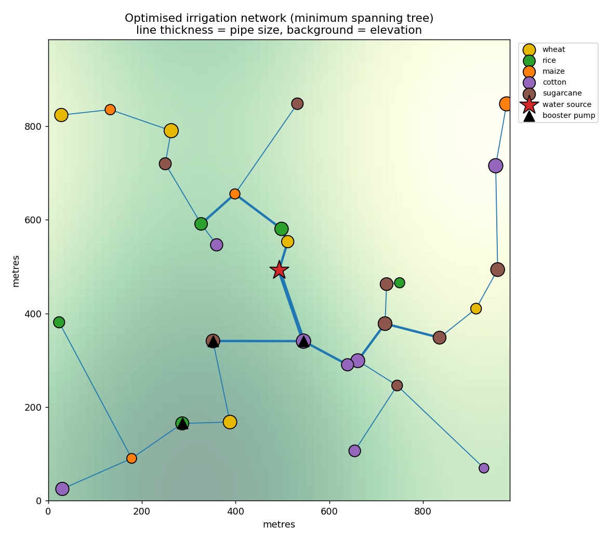

# Farm Irrigation Network Optimizer

A Python project that plans a **low-cost, low-waste irrigation system** for a farm. It finds the shortest pipe network, the best water routes, the right places for pumps, and a smart watering schedule.



*The red star is the water source. Dots are fields (colour = crop). Thicker blue lines are bigger pipes. Black triangles are booster pumps.*

---

## What does it do?

Think of the farm as a **map of points joined by lines**:

- **Points** = the water source and the fields
- **Lines** = pipes that could connect them

The program uses this map to answer six questions:

| # | Question | Method used |
|---|----------|-------------|
| 1 | What is the least pipe needed to reach every field? | Minimum Spanning Tree (Kruskal and Prim) |
| 2 | What is the best route for the water? What pipe size is needed? | Dijkstra's shortest path |
| 3 | Where do we need pumps and valves? | Greedy algorithm |
| 4 | When and how much should we water each field? | Greedy scheduler (uses soil, rain and water limit) |
| 5 | If water is short, which crops should get more? | Dynamic Programming |
| 6 | Does it still work fast on a big farm? | Speed test from 10 to 400 fields |

---

## Getting started

**You need:** Python 3.8 or newer.

```bash
# 1. Download the project
git clone https://github.com/YOUR-USERNAME/farm-irrigation-network.git
cd farm-irrigation-network

# 2. (Optional) install matplotlib to draw the map
pip install -r requirements.txt

# 3. Run it
python farm_irrigation.py
```

To try a different farm size, add the number of fields:

```bash
python farm_irrigation.py 60
```

The program prints a full report and saves the map as `farm_network.png`.
If matplotlib is not installed, everything still works, only the map is skipped.


## Results (30-field farm)

| What we measured | Normal way | Our way | Better by |
|------------------|-----------|---------|-----------|
| Pipe length | 10,575 m | 3,860 m | **63.5%** |
| Pipe cost | 42,299 | 20,798 | **50.8%** |
| Water lost in leaks | 52,874 L/day | 19,300 L/day | **63.5%** |
| Pump energy | 186.4 kWh/day | 144.0 kWh/day | **22.7%** |
| Water used in a season | 79,939 m³ | 70,497 m³ | **12%** |
| Water wasted | 19,244 m³ | 31 m³ | **99.8%** |
| Crop yield | 80.3% | 85.0% | **+4.6 points** |

*"Normal way" means: a separate pipe to every field, one big pump, and a fixed watering rota.*

### Speed test

| Fields | Possible pipes | Kruskal | Prim | Dijkstra |
|-------:|---------------:|--------:|-----:|---------:|
| 10 | 55 | 0.1 ms | 0.1 ms | 0.0 ms |
| 100 | 5,050 | 3.5 ms | 2.0 ms | 0.4 ms |
| 400 | 80,200 | 61 ms | 29 ms | 3 ms |

The bigger the farm, the more pipe the spanning tree saves (50% at 10 fields, 91% at 400 fields).

## How it works

1. **Spanning tree.** Start with all possible pipes. Pick the shortest pipes first, but skip any pipe that makes a loop. Stop when every field is connected. This gives the least total pipe.
2. **Routing.** Dijkstra finds the cheapest path from the source to each field. Going uphill costs extra because pumps need energy. Pipe size is chosen from how much water flows through it.
3. **Pumps and valves.** Walk from the source down the pipes and check the water pressure. Add a booster pump only where pressure becomes too low.
4. **Scheduling.** Every day, check each field's soil water and the rain forecast. Water the driest fields first and stop when the daily water limit is reached.
5. **Dynamic programming.** When there is not enough water for the whole season, try all ways to share it and keep the one that earns the most.

## Limits

This is a learning project with simple models, **not a real engineering design**.

- Farm data is simulated.
- Leaks, pressure and crop yield use simple formulas.
- The rain forecast is assumed to be perfect.
- Pump placement is a greedy method, so it may not be the very best. On large farms it can suggest too many small pumps.

## Ideas for the future

- Read the farm from a CSV file
- Use real weather data
- Add a drip irrigation option
- Port the code to C++ or Java
- Add a web page to draw the farm

## Author
Dimple Bhagat - [GitHub](https://github.com/dimplebhagat11)
